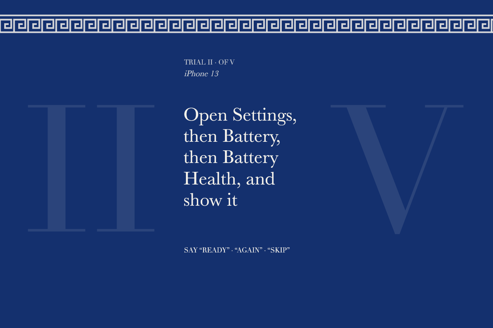
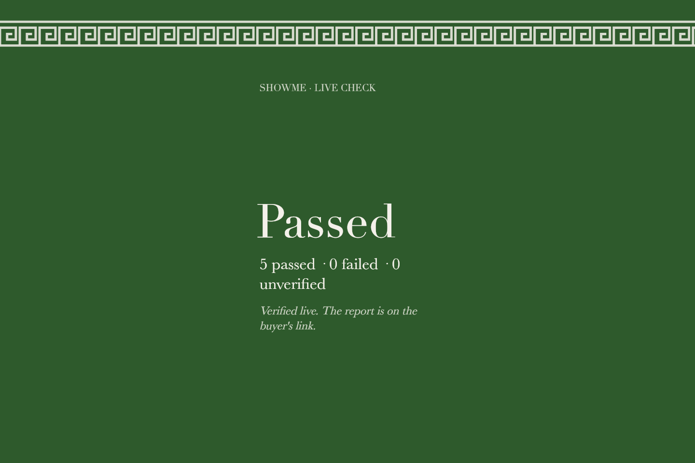
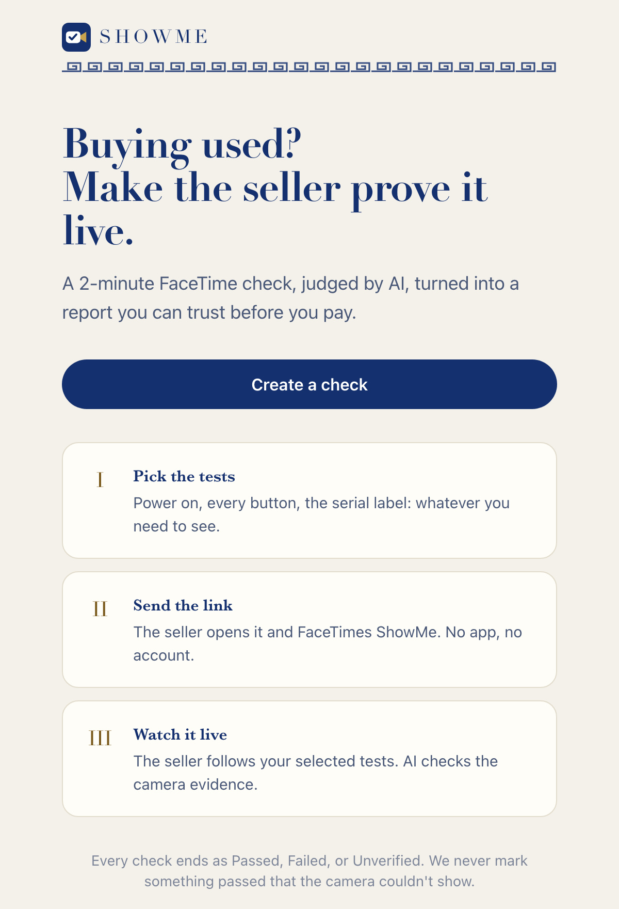
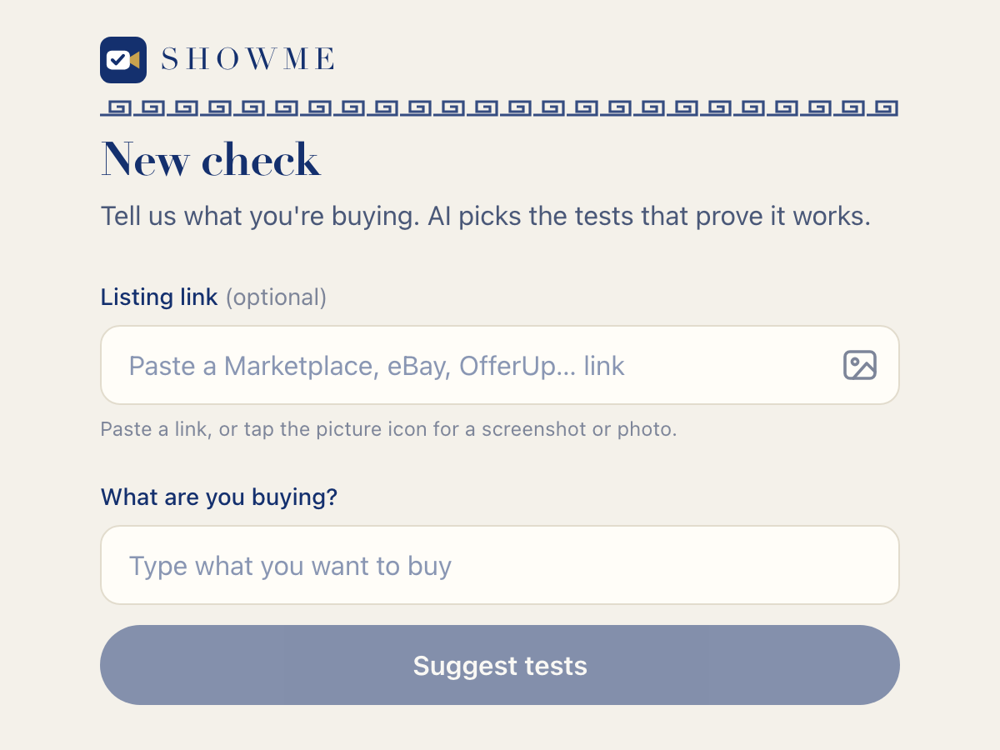
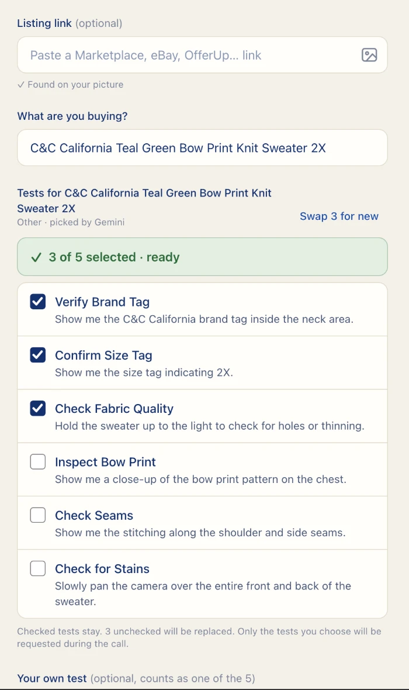
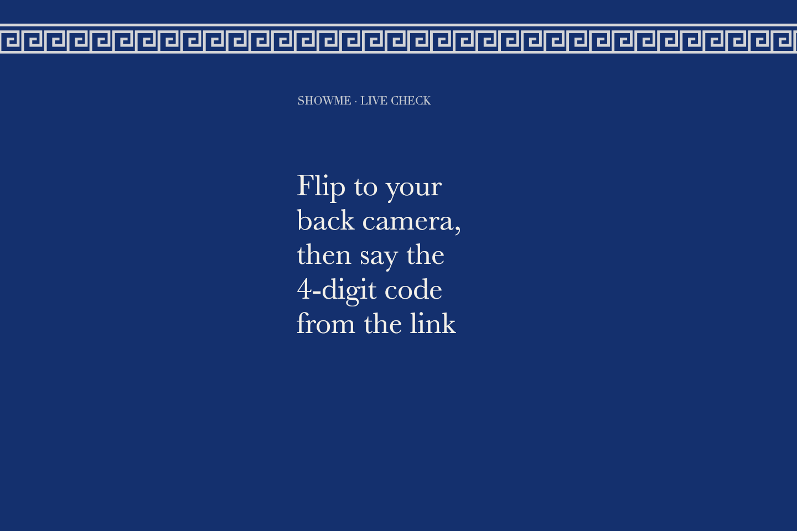
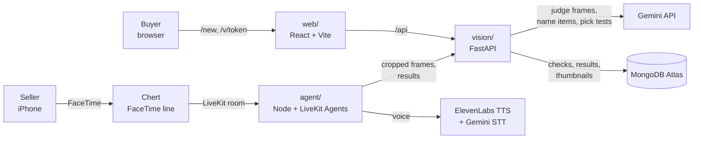

<div align="center">


# ShowMe

### Buying used? Make the seller prove it live.

A FaceTime check, run by an AI agent and judged by Gemini, that turns into a report you can trust before you pay.

**[showme.photo](https://showme.photo)** · Built in 24 hours at **HackUTA 2026**

</div>

<p align="center">
  
  
</p>

---

## The problem

Every used-item sale on Marketplace or OfferUp ends with the same message: *"Can you FaceTime me and show it works?"* Most sellers say yes, and the call proves very little:

- the seller decides what you see;
- the unit on camera may not be the one in the box;
- you're squinting at a blurry screen, trying to remember what to ask.

ShowMe puts the **buyer** in control of that call without being on it. The buyer picks what has to be shown, an agent makes the seller show it, and an AI judges each step from the live video.

## How it works

| | Who | What happens |
|---|---|---|
| **1** | Buyer | Pastes the listing link, a screenshot, or a photo of the item (or types it). Gemini names the item and suggests the tests that matter for it: battery health and Activation Lock for an iPhone, the brand and size tag for a sweater. The buyer keeps 3 to 5. |
| **2** | Buyer | Sends the check link to the seller. It holds a 4-digit code. |
| **3** | Seller | Taps the link to FaceTime ShowMe and says the code. No app, no account. |
| **4** | Agent | Speaks each task and shows it as a card in the video. The seller can say **"ready"**, **"again"** or **"skip"**. Each test gets up to 2 retries with a hint. |
| **5** | Gemini | Judges each test from the live frames: **Passed**, **Failed** or **Unverified**, with a one-line reason. |
| **6** | Buyer | Watches the same link turn into the report, live, with one thumbnail of evidence per test. Overall **Passed** needs at least 60% of the chosen tests to pass. |

**Wrong answers never pass.** A test the camera couldn't show is *Unverified*, never *Passed*. In our tests, a paper cup shown for "show the serial label" came back Unverified: *"no serial number or model label is visible"*.

## Screenshots

**The buyer's side** ([showme.photo](https://showme.photo))

<p align="center">
  
  
  
</p>

**The seller's FaceTime call.** The agent draws these cards on its own video track at 1440×960, the shape of FaceTime's video, so they read in both fit and fill modes.

<p align="center">
  
  
</p>
<p align="center">
  
</p>

## Architecture



| Part | Stack | Notes |
|---|---|---|
| **Call** | **Chert** FaceTime line, connected with `chert dev` | A real FaceTime number the seller already knows how to call |
| **Agent** | Node.js on **LiveKit Agents** | Hears the caller, publishes the task cards as a video track, runs the test flow |
| **Voice** | **Gemini** speech-to-text, **ElevenLabs** Flash v2.5 text-to-speech | Hears the code in a noisy hall; speaks fast enough to keep each check short |
| **Vision API** | Python **FastAPI** + **Gemini** | Judges each test, keeps one thumbnail, names items from links and photos, suggests tests |
| **Data** | **MongoDB Atlas** | One document per check: tests, attempts, results, one thumbnail each |
| **Web** | React + Vite + TypeScript + Tailwind | `/new` to create a check, `/v/<token>` for the live report |
| **Deploy** | **Vultr** VM on **Rocky Linux**, nginx, systemd, Let's Encrypt | One HTTPS origin: the web at `/`, the API at `/api` |

More detail, including the state machines and failure modes, is in [`docs/ARCHITECTURE.md`](docs/ARCHITECTURE.md). The API contract is [`shared/contract.md`](shared/contract.md).

### Privacy by design

- The caller's video reaches the agent as a capture of the Mac's FaceTime window, which shows the caller's **phone number**. The agent finds the video inside the frame and crops the number away **on the laptop**, so it never reaches our server or Gemini.
- We keep at most one small thumbnail per test (400 px wide) and drop every other frame after the check.

### Built to survive a busy demo

- Gemini latency on one model swung from 1 s to 40 s during the event. Item naming and test suggestions use `gemini-3.5-flash` and race a second model when the first is slow, so the page answers in about 2 to 4 s ([`vision/hedge.py`](vision/hedge.py)).
- If Gemini can't suggest tests at all, the page falls back to a standard list and says so, instead of claiming the AI picked them.

## Challenges

- **The video wasn't the camera.** We expected camera frames and got a 1280×720 picture of the FaceTime window, with the caller's video in a portrait strip that moved between calls. The agent now measures the strip on every call and drops any frame where it can't find it.
- **The first real call was too chatty.** It repeated every prompt and ran into the 5-minute call cap. Now each task is spoken once, hints go on screen, and tests run in a sensible order (power on, then settings screens, then the physical checks).
- **Speech-to-text and codes.** Gemini once heard "4827" as "427". The agent asks once more and only accepts exactly 4 digits that match a waiting check.

## Run it locally

Each folder has its own README. Every part has a mock mode, so you can run any one of them without the others.

```bash
# Vision API (Python 3.11+)
python3 -m venv vision/.venv && vision/.venv/bin/pip install -r vision/requirements-dev.txt
cp vision/.env.example vision/.env           # add GEMINI_API_KEY and MONGODB_URI, or set MOCK=1
vision/.venv/bin/uvicorn vision.main:app --port 8000

# Web (Node 22+)
cd web && npm install && npm run dev          # VITE_MOCK=1 npm run dev for mock data

# Agent (needs a Chert line and LiveKit keys)
cd agent && npm install && cp .env.example .env.local
npm start                                     # then, in a second terminal: npx @trychert/facetime dev
```

**Tests:** `vision/.venv/bin/python -m pytest -q vision/tests` (145 tests), `npm test` in `web/` (20) and in `agent/` (67).

## Repo layout

```
web/      React + Vite: /, /new, /v/:token, and the deploy scripts
vision/   FastAPI + Gemini + MongoDB Atlas, all routes under /api
agent/    Node: the Chert FaceTime agent on LiveKit
shared/   contract.md (the API), tests.json (standard tests), mock data
docs/     ARCHITECTURE.md, gallery/
```

## Sponsor tech, and where it runs

We only claim a sponsor if the live demo really calls it.

| Sponsor | What it does in ShowMe | Code |
|---|---|---|
| **Chert** | The seller's live FaceTime call | [`agent/`](agent) |
| **Gemini API** | Judges every test from the call frames; names items from links, screenshots and photos; suggests tests; hears the seller | [`vision/checker.py`](vision/checker.py), [`vision/listing.py`](vision/listing.py), [`vision/suggest.py`](vision/suggest.py), [`agent/agent.mjs`](agent/agent.mjs) |
| **MongoDB Atlas** | Stores checks, attempts, results and thumbnails | [`vision/store.py`](vision/store.py) |
| **ElevenLabs** | The agent's voice | [`agent/agent.mjs`](agent/agent.mjs) |
| **Vultr** (Rocky Linux, for CIQ) | Hosts the web app and the API | [`web/deploy/`](web/deploy) |
| **GoDaddy Registry** | `showme.photo`, a `.photo` domain | [`web/deploy/nginx-showme.conf`](web/deploy/nginx-showme.conf) |

## Team

Built at HackUTA 2026 by **Mahir** (agent, FaceTime call flow), **Wan** (web app, deploy) and **Youngjun** (vision API, Gemini, MongoDB).
