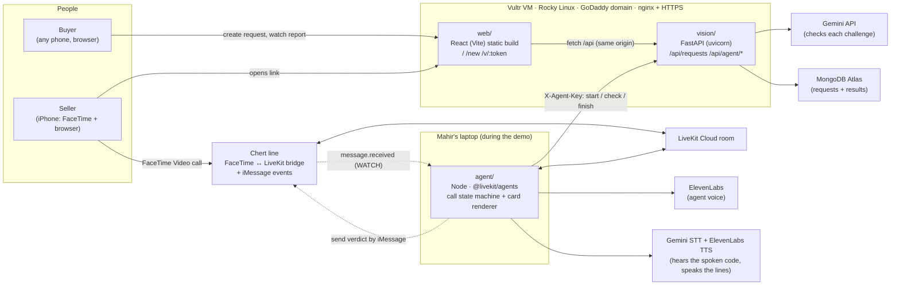
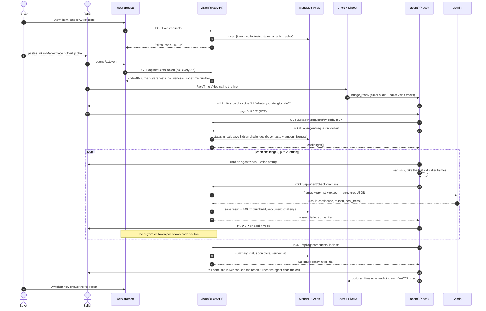
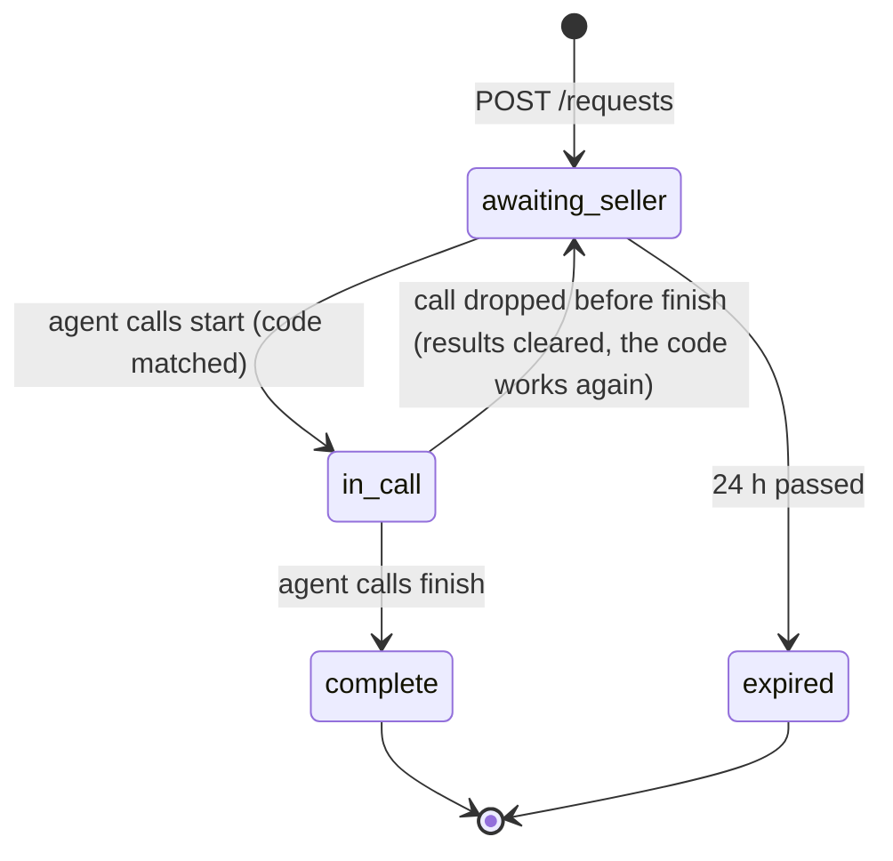
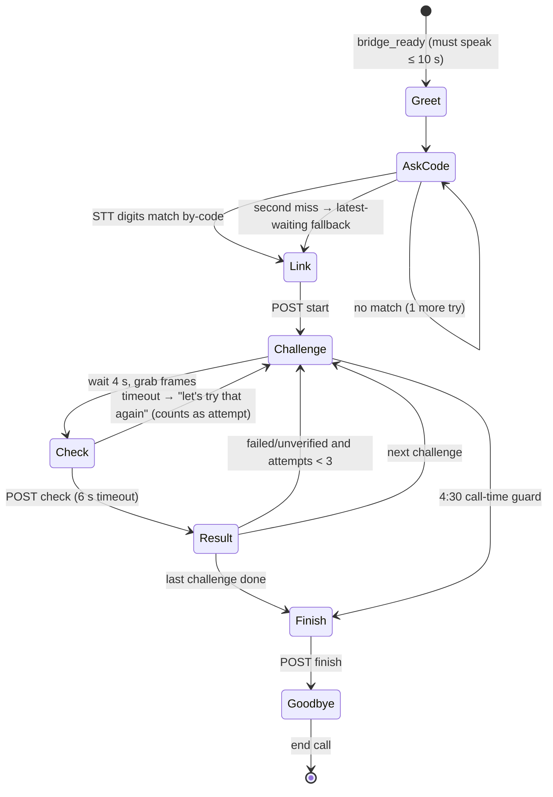
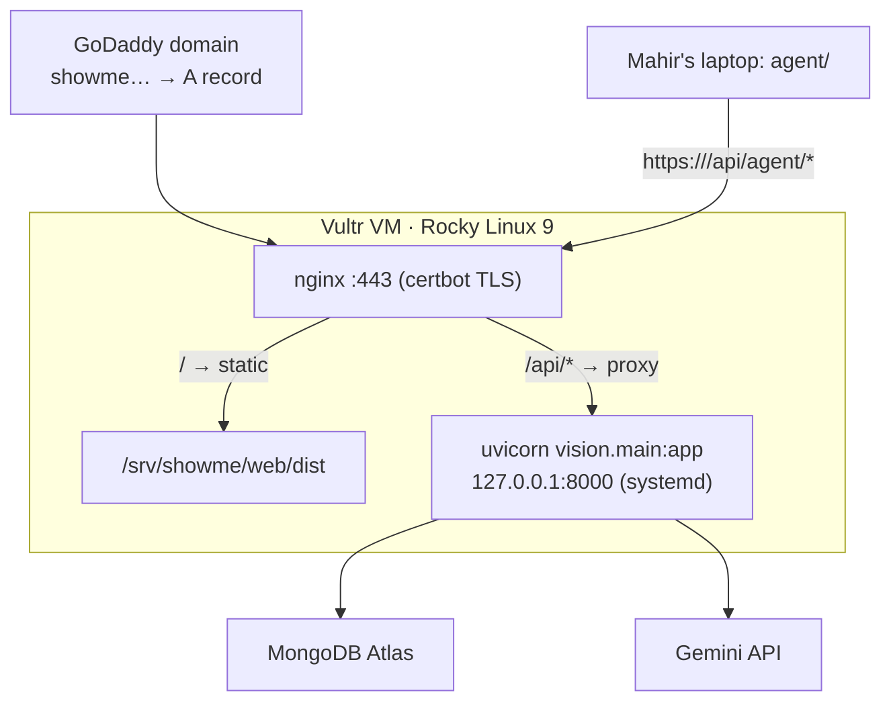

# ShowMe: architecture

> **Current Contract v5 update:** New inspections contain only buyer-selected tests (minimum three) and an optional custom test. No surprise challenges are generated. `summary.liveness` is `not_run`; historical reports retain their original liveness status. Attempts 1–3 retain metadata-only history and the final saved attempt determines the verdict. The agent announces retries, allows 12 seconds to act, uses a 30-second HTTP timeout, and reserves 15 seconds for finish within the 4:30 call budget. See `shared/contract.md`; older liveness diagrams/examples below are historical.

This is the technical design for the flow in `SHOWME_PLAN.md`. It covers:
- the API contract (`SHOWME_PLAN.md`, section 5, which stays the only source of truth for the API);
- who owns what, and the schedule (`SHOWME_PLAN.md`, sections 6 and 10).

Read this file to know **what each piece is, where it runs, and how the pieces talk to each other**.

---

## 1. The system at a glance



**Three runtimes:**

| Runtime | Where it runs | Owner | Why there |
|---|---|---|---|
| `web/` | Vultr VM: a static build served by nginx | Wan | A public URL on our domain that works on any phone |
| `vision/` | Vultr VM: uvicorn on `127.0.0.1:8000`, with nginx proxying `/api` to it | Youngjun | Public routes for the web app, and secret routes for the agent |
| `agent/` | **Mahir's laptop**, using `npm start` plus `chert dev --agent showme` | Mahir | The Chert CLI dev flow runs locally and handles room tokens and bridge setup, so no webhook is needed |

**Same origin on purpose:** the web app calls `/api/...` on its own domain, so there's no CORS to set up and nothing breaks at 3 AM.

---

## 2. The whole flow, step by step



---

## 3. State machines

### Request status (stored in MongoDB by `vision/`)



**Rules:**
- `code` is unique among `awaiting_seller` requests, and it's only shown while the status is `awaiting_seller`.
- `challenges[]` (which include the liveness challenges) are **never** returned by public routes. Only the `results[]` from a finished call show them.
- A dropped call means the agent's room ends without `finish`. The agent sends `POST /agent/requests/:id/abort`, which takes the request back to `awaiting_seller`. **This is a new route added to contract v3.**

### The agent's call (in `agent/`)



---

## 4. Inside `agent/` (Mahir)

```
agent/
  agent.mjs            Entry point from the Chert video starter: joins the room, wires everything up
  src/callFlow.mjs     The state machine above (pure functions, unit tested)
  src/cards.mjs        Renders a challenge card to RGBA 1280×720 with @napi-rs/canvas
  src/videoOut.mjs     Publishes a VideoSource at about 10 fps, from the SAME participant as the audio
  src/frames.mjs       Subscribes to facetime-remote-video, samples 2 fps into a 4-frame ring buffer, encodes to JPEG
  src/vision.mjs       HTTP client for /api/agent/* (X-Agent-Key, 6 s timeout, MOCK_VISION=1 mode)
  src/voice.mjs        ElevenLabs TTS through the LiveKit plugin; prompt lines cached
  src/code.mjs         Picks out 4 digits from the STT transcript ("four eight two seven", "4827")
  src/imessage.mjs     Optional: Chert SSE or dev-inbox, parses WATCH <code>, sends the verdict
  test/                node:test unit tests for callFlow, code and cards
```

**Video out (Risk 2):**
1. `@napi-rs/canvas` draws the card: the challenge text, the step counter "2 of 4", the result icon and a timer bar.
2. `ctx.getImageData()` gives RGBA, which becomes a `VideoFrame(RGBA, 1280, 720)`.
3. `videoSource.captureFrame()` sends it, in a 100 ms loop.
4. The track is published by the agent's local participant, the same one that publishes the TTS audio. There's exactly one audio publisher.

**Video in (Risk 1):**
- Turn on video subscription, and register `TrackSubscribed` handlers **before** joining the room.
- Filter for the participant `chert-bridge-*` and the track `facetime-remote-video`.
- Read frames with `VideoStream`, convert to RGBA, and keep every 15th frame (about 2 fps).
- Encode each kept frame with `sharp` to 640 px wide JPEG at quality 70. Keep the last 4.
- Clear the buffer when the track is muted or unpublished, so we never send a stale frame.

**Card style:**
- A large, high-contrast prompt, readable on a phone in a FaceTime window.
- A result banner: green ✅, red ❌ or amber ❓.
- A small "ShowMe · live check" watermark.

---

## 5. Inside `vision/` (Youngjun)

```
vision/
  main.py              FastAPI app: public routes /api/requests*, agent routes /api/agent/* (header check dependency)
  catalog.py           Loads shared/tests.json; builds challenges (buyer tests + 1-2 random liveness)
  checker.py           Gemini call: frames + prompt + expect → {result, confidence, reason, best_frame}
  store.py             MongoDB Atlas access (pymongo); MOCK=1 → in-memory dict
  thumbs.py            best_frame → 400 px JPEG → base64 data URL
  tests/               pytest: contract shapes, liveness hidden before call, state transitions, checker on test_frames/
```

**The Gemini check (`checker.py`):**
- **Model:** a fast Flash model (pick it at hour 0 by speed). The time limit for each check is under 3 seconds.
- **Input:** 2 to 4 JPEG frames, plus a text prompt holding the challenge `prompt`, the `expect` string and the rules:
  - "Answer **unverified** if the view is too dark, too blurry, or doesn't show the item clearly."
  - "Answer **failed** only if you can see that the requirement is NOT met."
  - "Never assume something you can't see."
- **Output:** a JSON schema with `result` (an enum of passed, failed and unverified), `confidence` (0–1), `reason` (one sentence) and `best_frame` (an integer).
- **After Gemini answers:**
  - `passed` with confidence under 0.7 becomes `unverified`.
  - The final result is the last attempt's result.
  - The number of attempts is stored.
- **Liveness challenges:** the finger-count `expect` includes the random N, for example "exactly 3 fingers held up next to the item". This is what defeats a recording.

**The MongoDB document (one collection, `requests`):**

```json
{
  "_id": "ObjectId",
  "token": "k3v9x2m7qp",              "code": "4827",
  "item_name": "PS4 controller",       "category": "console",   "listing_url": "https://...",
  "tests": ["power_on", "buttons"],    "custom_test": null,
  "status": "awaiting_seller | in_call | complete | expired",
  "challenges": [ { "id": "c1", "kind": "buyer|liveness|custom", "prompt": "...", "expect": "..." } ],
  "current_challenge": { "prompt": "Hold up 3 fingers next to it", "attempt": 1 },
  "results": [ { "challenge_id": "c1", "kind": "liveness", "prompt": "...", "result": "passed",
                 "confidence": 0.91, "reason": "...", "attempts": 2, "thumb": "data:image/jpeg;base64,..." } ],
  "summary": { "passed": 3, "failed": 0, "unverified": 1, "total": 4, "liveness": "passed" },
  "watch_chat_ids": ["..."],
  "created_at": "...", "expires_at": "...", "verified_at": "..."
}
```

**Indexes:**
- `token`, unique.
- `{code: 1, status: 1}`.
- `expires_at`. Expiry is checked when the request is read; there's no TTL delete, so reports stay.

**The public view** is built by a single `public_view(doc)` function. It removes `challenges`, `watch_chat_ids` and `_id`, and it removes `code` unless the status is `awaiting_seller`. A test enforces this.

---

## 6. Inside `web/` (Wan)

```
web/
  src/pages/Home.tsx        /         The buyer landing page: "Buying used? Make the seller prove it live."
  src/pages/NewCheck.tsx    /new      Item, category, test picker (from shared/tests.json), free-text test → link, copy button, QR code
  src/pages/Verify.tsx      /v/:token One page, three states:
                                        awaiting_seller → seller instructions, a big code, a facetime: button, the buyer's tests, "Text me the result"
                                        in_call         → "Live now", the current challenge, results ticking in (poll every 2 s)
                                        complete        → the report: a banner (verified / issues / "possible recording"), rows with thumbnails, the time
  src/api.ts                Typed client for /api (MOCK mode reads shared/mock_request.json)
  public/og.png             The share card (nice to have)
```

**Rules:**
- **The buyer and the seller see the same URL.** The page changes by status, not by who is looking. There's no login.
- **Mobile first:** a judge will open it on their own phone.
- **Report banner logic:**
  - If liveness failed, show "Live check failed: possible recording" (red).
  - Otherwise, if everything passed, show "Verified live" (green).
  - Otherwise, show "N passed · N failed · N unverified" (amber).

---

## 7. Deployment



**Deploy steps (Wan and Youngjun, 10:30 PM):**
1. `dnf install nginx python3.11 git certbot python3-certbot-nginx`.
2. Clone the repo into `/srv/showme`.
3. Create a venv and `pip install -r vision/requirements.txt`.
4. Write a systemd unit for uvicorn, with an `EnvironmentFile=/srv/showme/.env`.
5. Build `web/` locally (`npm run build`), then rsync `dist/` to the server.
6. Set up an nginx server block, then run `certbot --nginx -d <domain>`.
7. Open ports 80 and 443 in the Vultr firewall and in `firewalld`.

**Fallback if the deploy fails (cut at 5 AM):**
- Run `vision/` and `web/` on a laptop behind a tunnel.
- **Drop the Vultr and CIQ prize claims.**

---

## 8. Secrets and config (`.env`, never committed; `.env.example` lists the names only)

| Name | Used by | Notes |
|---|---|---|
| `GEMINI_API_KEY` | vision | Turn on billing if the free tier's rate limit is too low |
| `MONGODB_URI` | vision | Atlas free cluster |
| `AGENT_KEY` | vision, agent | A random 32-character string; protects `/api/agent/*` |
| `PUBLIC_BASE_URL` | vision | Builds `link_url` |
| `LINE_NUMBER` | vision | Shown on `/v/:token` for the FaceTime button |
| `MOCK` | vision | `1`: in-memory store and canned results |
| `VISION_URL` | agent | `https://<domain>/api`, or `http://localhost:8000/api` when developing |
| `LIVEKIT_URL`, `LIVEKIT_API_KEY`, `LIVEKIT_API_SECRET` | agent | From the Chert starter setup |
| `GOOGLE_API_KEY` | agent | Gemini speech-to-text (spoken code). Voice is ElevenLabs. `VOICE=openai` + `OPENAI_API_KEY` is the fallback for both |
| `ELEVENLABS_API_KEY`, `ELEVENLABS_VOICE_ID` | agent | Agent voice |
| `CHERT_API_KEY`, `CHERT_PROJECT_ID` | agent | Only for the iMessage `WATCH` extra |
| `MOCK_VISION` | agent | `1`: skip HTTP and use canned results |
| `VITE_MOCK` | web | `1`: read `shared/mock_request.json` |

---

## 9. What can fail, and what the system does

| Failure | Where it's caught | What happens |
|---|---|---|
| The spoken code isn't recognized | agent `AskCode` | One retry, then `latest-waiting` |
| No caller frames (camera muted or the track was lost) | agent `frames.mjs` | Card: "I can't see you, point the camera at the item." The attempt isn't used up |
| Gemini is slow or errors | agent (6 s timeout), vision (try/except) | Counts as an attempt: "let's try that again". After 3 attempts the result is `unverified` |
| The call drops partway through | agent room-disconnect handler | `POST abort`, the request goes back to `awaiting_seller`, and the code works again |
| The call is about to hit the 5-minute cap | agent 4:30 guard | Finish with whatever is done; untested challenges become `unverified` |
| A recording is held up to the camera | vision liveness `expect` | Liveness `failed`, and the report gets the red "possible recording" banner |
| The vision server goes down | agent / web | The agent uses `MOCK_VISION=1` (a demo fallback, said honestly); the web shows "Can't reach ShowMe, retrying" |
| No network at the judging table | everyone | Laptop hotspot, then a plain LiveKit room, then mock mode, then the backup video (`SHOWME_PLAN.md`, section 7) |

---

## 10. Contract change found while designing this

- **Add `POST /api/agent/requests/{id}/abort`** (agent only). It takes `in_call` back to `awaiting_seller` and clears partial results. Without it, a dropped call leaves the request stuck.
- **Every route now lives under `/api`,** because nginx serves the web app at `/` and the API at `/api`.

Both changes are also written into `SHOWME_PLAN.md`, section 5.
